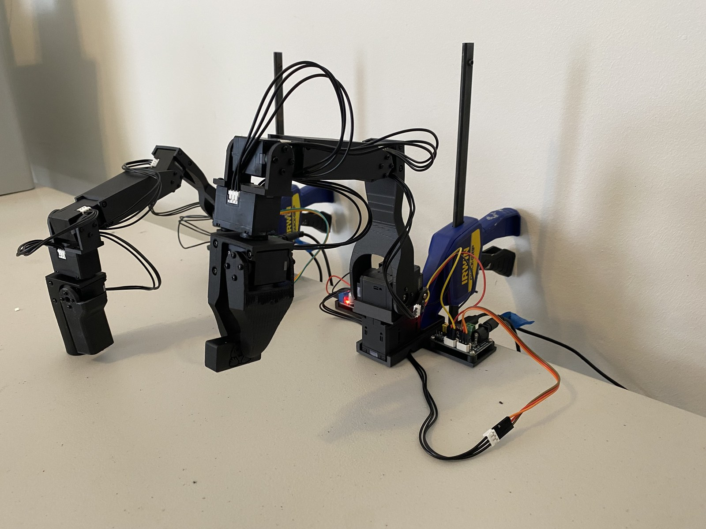

# Koch v1.1 Leader-Follower Robot Arm Pair (Refurbished)



A pair of small 6-axis robot arms for teaching by demonstration. Move the leader by hand and the follower copies it; record the demonstrations and train a policy with Hugging Face LeRobot. This is a refurbished remix of [Koch v1.1](https://github.com/jess-moss/koch-v1-1) by Jess Moss (Hugging Face LeRobot), based on Alexander Koch's low_cost_robot.

## Install and build guide

### 1. Print the parts

PLA+ (or PETG/ABS), 0.2 mm layers or finer, 0.4 mm nozzle max, about 30% infill. Glue stick on the bed helps.

Leader arm (one each): Leader_Base, Leader_Shoulder_To_Elbow, Leader_Elbow_To_Wrist, Leader_Elbow_To_Wrist_Extension, Leader_Gripper_Handle, Leader_Gripper_Trigger, Leader_Platform (optional, lets the follower reach the table surface).

Follower arm (one each): Follower_Base, Follower_Shoulder_Rotation, Follower_Shoulder_To_Elbow, Follower_Elbow_To_Wrist, Follower_Elbow_To_Wrist_Extension, Follower_Gripper_Static_Part, Follower_Gripper_Moving_Part.

Two ROBOTIS sets are bought directly from ROBOTIS and are not in the shop list:

- ROBOTIS FPX330-S101 frame set (1 set): the leader's small frame. It is not a printed part.
- ROBOTIS HN11-I101 idler set for XL430 (1 set): the follower's XL430 joints.

### 2. Prepare the servos

1. Install LeRobot (https://github.com/huggingface/lerobot) on your computer in a Python virtual environment.
2. Connect one servo at a time to a driver board and give each a unique ID (1 to 6, base to gripper) and a baud rate as LeRobot's Koch setup expects.
3. Label each servo with its arm and ID.

### 3. Assemble the arms

1. Follow the joint order base -> shoulder -> elbow -> wrist -> gripper. Fit the idler wheels opposite each servo horn.
2. Follower: XL430s at the shoulder lift and elbow, XL330-M288s at base rotation, wrist flex, wrist roll and gripper.
3. Leader: XL330-M077 at every joint.
4. Leader platform: press four M2 nuts into the pockets under `Leader_Platform`, then fasten it to `Leader_Base` with four M2x5 screws. Remove the driver board first to reach the two screws under it.
5. Daisy-chain the servo cables joint to joint and leave slack at each joint for full travel.

### 4. Power and wiring

- Leader: 5 V supply into its driver board, servo chain into the board, USB to the computer.
- Follower: 12 V supply into its driver board for the XL430s. Feed the XL330 servos through the 12 V to 5 V step-down. Measure the step-down output with a multimeter before connecting any XL330.
- Clamp both bases to the table.

### 5. Calibrate and teleoperate

1. Run LeRobot's calibration for both arms and move each joint through the poses it asks for.
2. Start teleoperation at low speed. The follower should mirror the leader.
3. Record episodes and train a policy with LeRobot when teleoperation is smooth.

### Safety

- Never put 12 V on the XL330 servos.
- Keep fingers clear of the follower gripper while it is powered.
- Unplug power before changing cables.

## Bill of Material

[Bill of Material (PDF)](docs/Koch%20v1.1%20Robot%20Arm%20Pair%20-%20Bill%20of%20Material.pdf): every part to buy, with shop links.

## Documentation download

This repository is the documentation and source download for the build.

- **Download ZIP:** use GitHub's **Code → Download ZIP** button, or clone:

  ```bash
  git clone https://github.com/ToolKnox/hawkridge-koch-v1-1-low-cost-robot-arm.git
  ```

- **Build guide:** this README, also as [`docs/build-guide.md`](docs/build-guide.md).
- **Leader arm print files (STL):** [`source/upstream/hardware/leader/STL/`](source/upstream/hardware/leader/STL/)
- **Follower arm print files (STL):** [`source/upstream/hardware/follower/STL/`](source/upstream/hardware/follower/STL/)
- **Editable STEP and SolidWorks parts:** [`source/upstream/hardware/`](source/upstream/hardware/)
- **LeRobot (control software):** https://github.com/huggingface/lerobot
- **Original upstream README:** [`source/upstream/README.md`](source/upstream/README.md)

## Repository contents

- `docs/`: the build guide.
- `download-documentation/`: how to download this package.
- `images/`: cover photo.
- `source/upstream/`: mirror of the upstream project at commit `1a553e1fa7d5404b51bbd83b99b0f7eba54888e0`, with the Koch-designed STL, STEP and SolidWorks parts, wiring notes and photos.

Not included in this repository: the ROBOTIS servo, frame and idler models, the assemblies that embed them, and the logo blocks. Buy the ROBOTIS FPX330-S101 and HN11-I101 sets from ROBOTIS.

## Credits and license

Remix of [Koch v1.1](https://github.com/jess-moss/koch-v1-1) by Jess Moss (Hugging Face LeRobot), based on Alexander Koch's low_cost_robot, Apache License 2.0 (parent design MIT). It is an improved version of [low_cost_robot](https://github.com/AlexanderKoch-Koch/low_cost_robot) by Alexander Koch (MIT License). Mirrored from commit [`1a553e1`](https://github.com/jess-moss/koch-v1-1/tree/1a553e1fa7d5404b51bbd83b99b0f7eba54888e0). The upstream license is kept at [`LICENSE`](LICENSE) and [`source/upstream/LICENSE`](source/upstream/LICENSE). The parent MIT notice is at [`LICENSE-parent-MIT.txt`](LICENSE-parent-MIT.txt).

Changes by Hawkridge, updated for modern use: one combined leader and follower bill of materials, the ROBOTIS frame and idler sets bought instead of printed, and this rewritten print, power and assembly guide for current LeRobot. Files under `source/upstream/` are unmodified.
